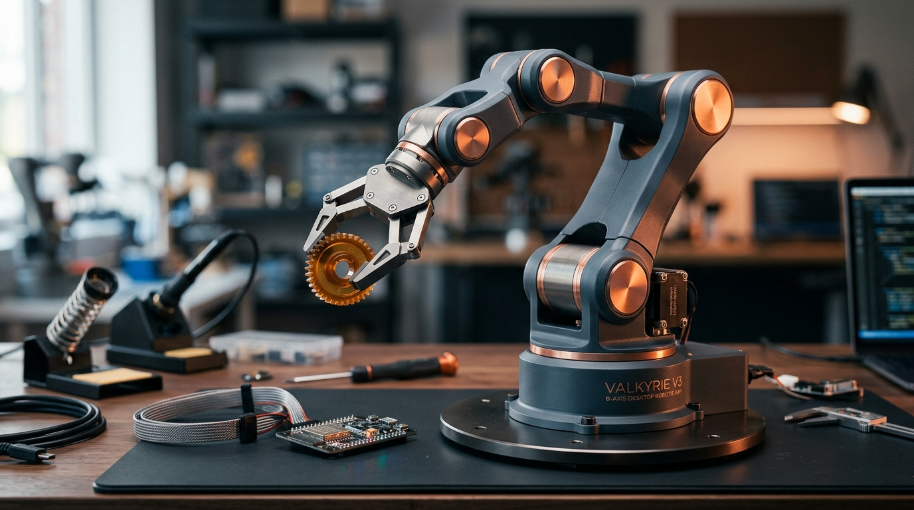
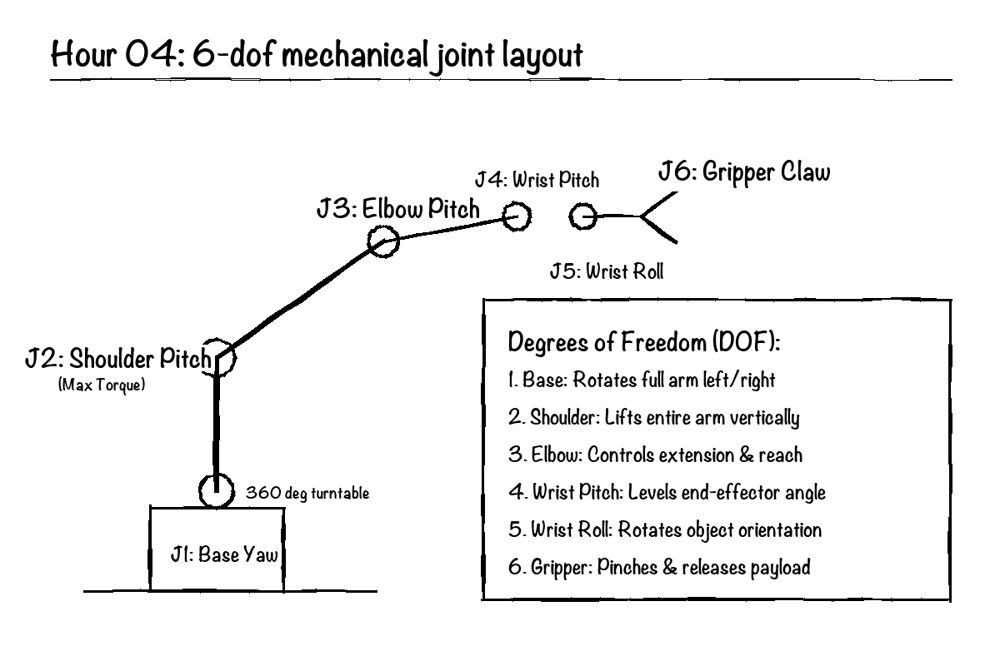
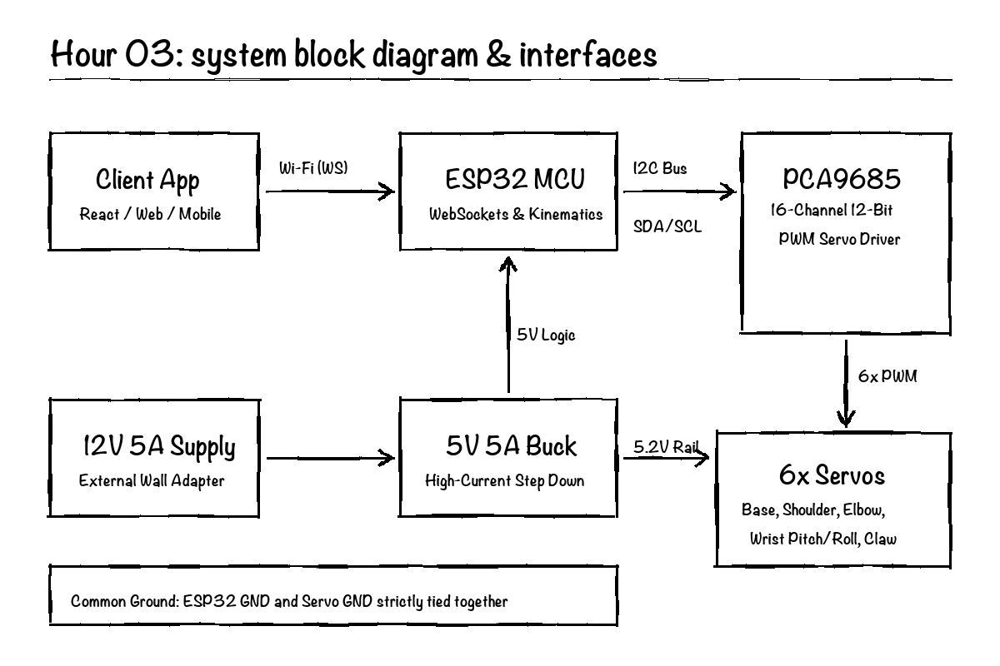
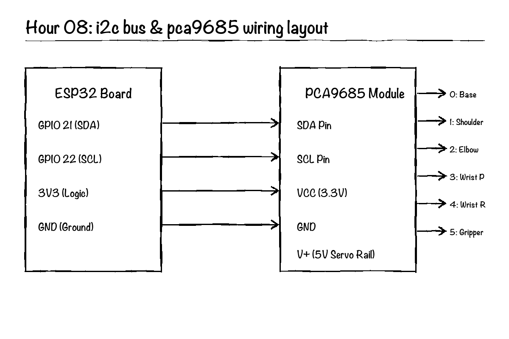
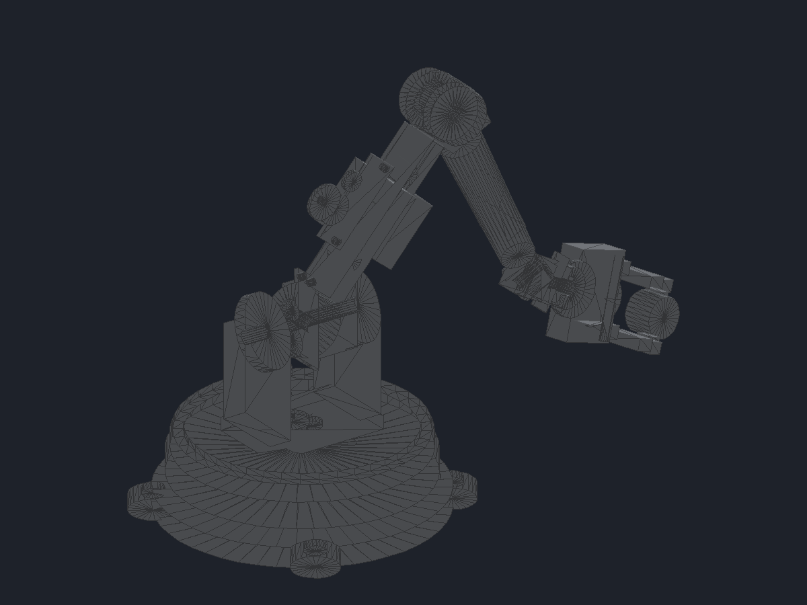
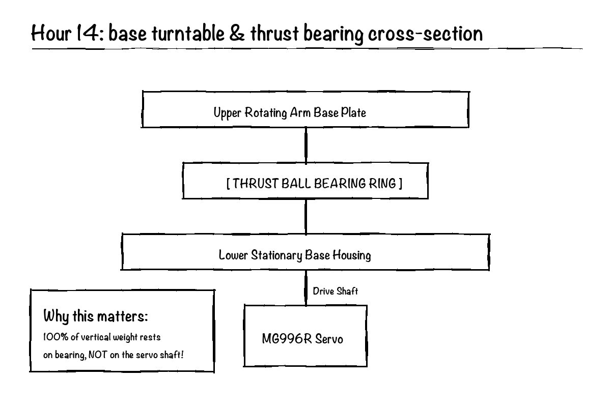
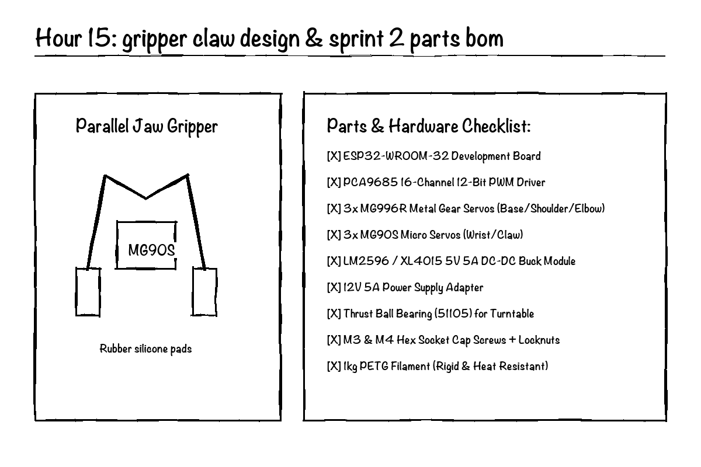

# Valkarye V3

A high-performance, open-source 6-axis desktop robotic arm built with 3D-printed PETG parts, high-torque metal gear servos, an ESP32 microcontroller, and a real-time WebSockets control interface with voice commands.



---

## Overview

Valkarye V3 is a complete redesign of an earlier desktop robotic arm project. The goal with V3 is to build a reliable, rigid, and genuinely functional robotic arm capable of precision object manipulation, smooth multi-axis trajectory execution, and low-latency wireless control from a phone or laptop.

The mechanical assembly uses a heavy thrust-bearing turntable base to eliminate wobble, I-beam bicep trusses with dual 608ZZ bearings for high torsional stiffness, and a synchronized parallel jaw gripper with high-friction silicone pads.

---

## Key Specifications

- Degrees of Freedom: 6 independent axes (Base Yaw, Shoulder Pitch, Elbow Pitch, Wrist Pitch, Wrist Roll, Parallel Gripper)
- Maximum Reach: 330 mm spherical radius (optimal pickup envelope: 150 mm to 250 mm)
- Payload Capacity: 250 g at full extension, up to 450 g at half extension
- Actuators:
  - 3x MG996R high-torque metal gear servos (Base, Shoulder, Elbow)
  - 3x MG90S lightweight micro servos (Wrist Pitch, Wrist Roll, Parallel Gripper)
- Controller: ESP32-WROOM-32 (240MHz dual-core, Wi-Fi 802.11 b/g/n)
- PWM Driver: PCA9685 16-channel 12-bit I2C servo driver (400kHz Fast-Mode)
- Power System: 12V 5A DC input stepped down to 5.2V 5A via high-efficiency buck converter with a 1000uF low-ESR smoothing capacitor
- Communication Protocol: Bi-directional WebSockets running at 50Hz (<16ms round-trip latency)
- Companion App: Cross-platform web and mobile interface with interactive joint sliders, live telemetry, and Web Speech API voice control

---

## 6-Axis Kinematics & Degrees of Freedom



| Axis | Joint | Motion | Actuator | Angular Range | Purpose |
|---|---|---|---|---|---|
| 1 | Base | Yaw (horizontal swivel) | MG996R | 0 to 180 deg | Arm heading and radial positioning |
| 2 | Shoulder | Pitch (vertical lift) | MG996R | -15 to +105 deg | Primary vertical lift and reach extension |
| 3 | Elbow | Pitch (forearm flex) | MG996R | 0 to 135 deg | Working distance and vertical elevation |
| 4 | Wrist | Pitch (tilt) | MG90S | -90 to +90 deg | End-effector orientation and leveling |
| 5 | Wrist | Roll (continuous swivel) | MG90S | 0 to 180 deg | Gripper tool orientation |
| 6 | Gripper | Linear parallel pinch | MG90S | 0 to 65 mm | Object grasping with soft silicone pads |

---

## System Architecture



The control architecture is split into three clean layers:
1. Client Layer: The web/mobile companion app captures user slider inputs or voice commands, parses the kinematic intent, and transmits compact JSON packets over WebSockets.
2. Microcontroller Layer: The ESP32 receives packets at 50Hz, validates software endstops, executes smooth S-curve velocity acceleration curves, and transmits 12-bit target duty cycles over I2C to the PCA9685 driver.
3. Power & Actuation Layer: The PCA9685 delivers hardware-timed 50Hz PWM signals to the 6 servos. An external 5.2V 5A buck regulator supplies motor current through a dedicated ground plane, protecting the ESP32 from voltage drops and electrical noise.

---

## Wiring & Electrical Schematic



### Pin Connections

- ESP32 GPIO 21 -> PCA9685 SDA (I2C Data)
- ESP32 GPIO 22 -> PCA9685 SCL (I2C Clock)
- ESP32 3.3V -> PCA9685 VCC (Logic Power)
- ESP32 GND -> Common Ground Rail
- Buck Converter (+5.2V) -> PCA9685 V+ (Servo Power Rail)
- Buck Converter (GND) -> PCA9685 GND & ESP32 GND (Common Rail)
- 1000uF 16V Low-ESR Capacitor across PCA9685 V+ and GND terminals

---

## CAD Source Files & 3D Printable Models

All 3D mechanical parts are designed for printing in PETG with 4 perimeters and 40% gyroid infill for maximum stiffness and heat resistance.

### 3D CAD Preview & Assembly



### Parametric CAD Source Files (`cad/`)
- [`cad/valkarye_v3_assembly.step`](cad/valkarye_v3_assembly.step): Universal ISO 10303-21 STEP 3D assembly model (compatible with Fusion 360, SolidWorks, FreeCAD, Onshape).
- [`cad/valkarye_v3_assembly.scad`](cad/valkarye_v3_assembly.scad): Full parametric OpenSCAD source file with kinematics hierarchy and dimensional variables.
- [`cad/01_base_turntable.scad`](cad/01_base_turntable.scad): Parametric base housing with 51105 thrust bearing recess and M4 clamp bores.
- [`cad/02_bicep_truss.scad`](cad/02_bicep_truss.scad): 140mm center-to-center I-beam truss with dual 608ZZ bearing seats.
- [`cad/03_parallel_gripper.scad`](cad/03_parallel_gripper.scad): Parametric synchronized dual gear-rack gripper frame.

### 3D Printable STL Models (`stl/`)
- [`stl/valkarye_v3_full_assembly.stl`](stl/valkarye_v3_full_assembly.stl): Complete assembled 6-axis robotic arm model (QuickLook & 3D viewer ready).
- [`stl/01_base_housing.stl`](stl/01_base_housing.stl): Stationary lower base housing with cable bore and desk mounts.
- [`stl/02_turntable_plate.stl`](stl/02_turntable_plate.stl): Rotating turntable plate with bearing alignment boss.
- [`stl/03_shoulder_bracket.stl`](stl/03_shoulder_bracket.stl): Shoulder clevis bracket with servo horn clamp pockets.
- [`stl/04_bicep_truss.stl`](stl/04_bicep_truss.stl): 140mm bicep link with diagonal reinforcement ribs.
- [`stl/05_elbow_clevis.stl`](stl/05_elbow_clevis.stl): Double-shear elbow joint clevis.
- [`stl/06_forearm_link.stl`](stl/06_forearm_link.stl): 130mm forearm link with internal wire channel.
- [`stl/07_wrist_mount.stl`](stl/07_wrist_mount.stl): Dual-axis pitch/roll wrist bracket.
- [`stl/08_gripper_frame.stl`](stl/08_gripper_frame.stl): Parallel jaw guide frame with servo recess.
- [`stl/09_gripper_jaw_left.stl`](stl/09_gripper_jaw_left.stl): Left gripper finger with silicone friction pad slot.
- [`stl/10_gripper_jaw_right.stl`](stl/10_gripper_jaw_right.stl): Right gripper finger with silicone friction pad slot.

---

## Mechanical Details

### Turntable Base & Thrust Bearing
The base joint incorporates a 51105 thrust ball bearing (42mm OD, 25mm ID, 12mm thickness) between the rotating turntable and the stationary base plate. All axial downward loads and tilting moments are absorbed directly by the bearing race, keeping the base servo free from radial and thrust stress.



### Synchronized Parallel Gripper
The gripper uses a central 14-tooth spur pinion gear driven by an MG90S micro servo to simultaneously move two opposing linear gear racks. Both jaws stay parallel across the entire 0 mm to 65 mm stroke, with replaceable grooved silicone pads that provide high-friction grip on cylindrical, square, or flat objects.



---

## Firmware & Communication

The firmware runs on the ESP32 using the Arduino framework and the `ESPAsyncWebServer` library for high-frequency WebSockets communication.

### WebSockets Control Packet Format

```json
{
  "cmd": "move",
  "base": 90,
  "shoulder": 45,
  "elbow": 110,
  "wrist_pitch": 80,
  "wrist_roll": 90,
  "gripper": 35,
  "speed": 100
}
```

### Telemetry Heartbeat Packet

The ESP32 broadcasts a telemetry packet back to connected clients every 50ms:

```json
{
  "status": "online",
  "v_in": 5.18,
  "current_a": 1.42,
  "angles": [90, 45, 110, 80, 90, 35],
  "ping_ms": 14
}
```

---

## Bill of Materials

| Component | Quantity | Specification / Description |
|---|---|---|
| ESP32 Development Board | 1 | ESP32-WROOM-32 30-pin microcontroller |
| PCA9685 PWM Driver | 1 | 16-channel 12-bit I2C servo controller |
| MG996R Metal Gear Servo | 3 | High-torque metal gear (Base, Shoulder, Elbow) |
| MG90S Micro Servo | 3 | Lightweight metal gear (Wrist Pitch, Roll, Gripper) |
| DC-DC Buck Converter | 1 | 12V to 5.2V 5A step-down module |
| 12V 5A Power Supply | 1 | 100-240V AC to 12V DC wall adapter |
| 51105 Thrust Ball Bearing | 1 | 25mm ID x 42mm OD x 12mm thickness |
| 608ZZ Ball Bearings | 2 | 8mm ID x 22mm OD x 7mm thickness |
| Low-ESR Capacitor | 1 | 1000uF 16V electrolytic capacitor |
| Brass Heat-Set Inserts | 12 | M3 x 5.7mm brass threaded inserts |
| Metric Fasteners | 1 kit | M3 and M4 socket head screws with nyloc nuts |
| 3D Printer Filament | 1 roll | 1kg PETG filament (Black / Silver) |

---

## License

This project is licensed under the MIT License. Developed for Hack Club Half Life.
